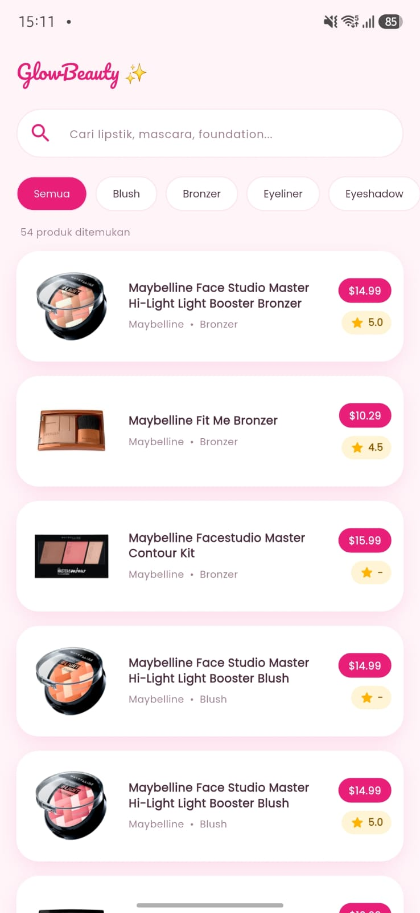
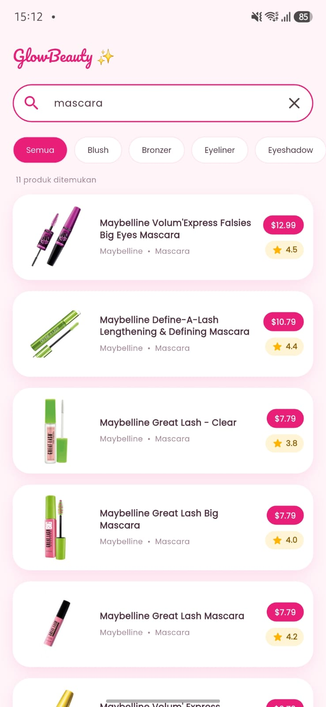
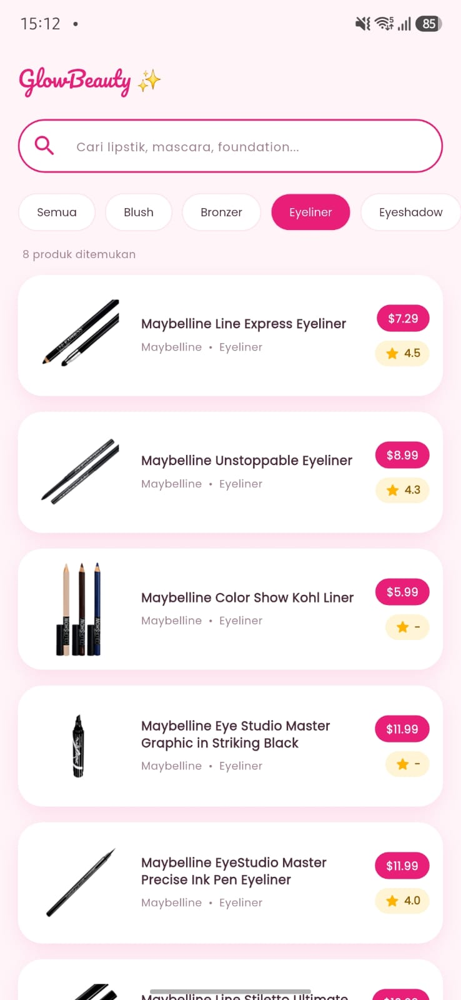
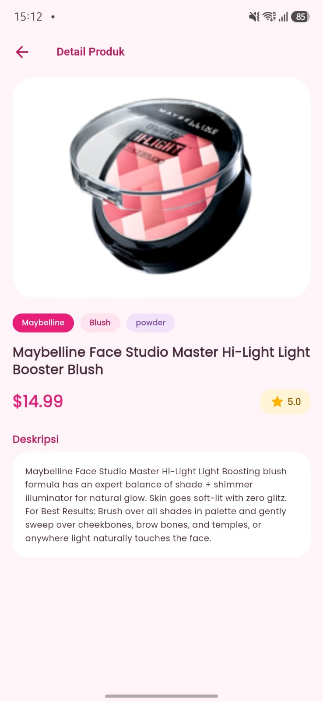
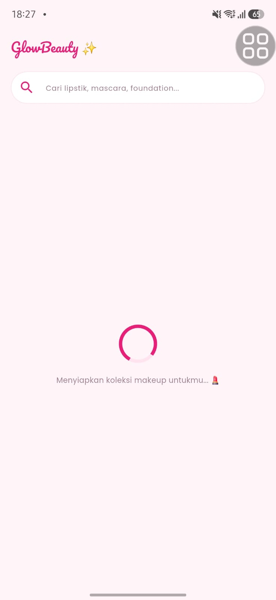
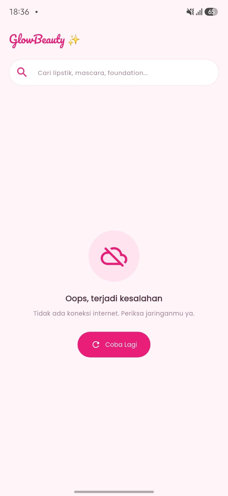

# GlowBeauty ✨ — Katalog Makeup Maybelline (Flutter)

Aplikasi katalog produk makeup **Maybelline** berbasis Flutter yang mengambil data secara asinkron dari [Makeup API](https://makeup-api.herokuapp.com/) dan menampilkannya dengan `FutureBuilder`.

> Proyek Ujian Tengah Semester (UTS) — Pemrograman Mobile.
> Penulis: **<Dika Larasati>** · NIM **<240605110028>** · <Teknik Informatika>, <UIN Malang>

## Deskripsi Singkat

GlowBeauty membantu pengguna menjelajahi koleksi produk kecantikan Maybelline: melihat nama, jenis produk, harga, rating, pilihan warna, dan deskripsi lengkap. Data diambil langsung dari API sehingga selalu bersumber dari penyedia data, bukan data statis. Antarmuka dibuat dengan tema pink yang bersih dan mudah dibaca.

Sumber data:

```
GET https://makeup-api.herokuapp.com/api/v1/products.json?brand=maybelline
```

## Fitur Utama

- 📋 **Daftar produk** berbentuk kartu: gambar (kiri), nama + brand & jenis (tengah), harga + rating (kanan).
- 🔍 **Pencarian real-time** pada AppBar (berdasarkan nama, jenis, atau kategori).
- 🏷️ **Filter jenis produk** (Blush, Bronzer, Eyeliner, dst.) dalam bentuk chip.
- 🖼️ **Halaman detail**: foto besar, brand, jenis, kategori, harga, rating, pilihan warna, dan deskripsi.
- ⏳ **Penanganan state `FutureBuilder`**: *loading*, *success*, dan *error* (dengan tombol **Coba Lagi**).
- 🔄 *Pull-to-refresh* untuk memuat ulang data.
- 🛡️ **Aman terhadap data kosong**: rating, kategori, harga, dan warna yang bernilai `null` tidak membuat aplikasi *crash*.

## Struktur Folder

```
lib/
├── main.dart                       # Entry point aplikasi
├── theme/app_theme.dart            # Palet warna & tema
├── models/product.dart             # Model Product & ProductColor
├── services/product_service.dart   # HTTP GET ke Makeup API
├── screens/
│   ├── home_screen.dart            # Daftar produk + search + FutureBuilder
│   └── detail_screen.dart          # Detail produk
└── widgets/
    ├── product_card.dart           # Kartu produk
    ├── product_image.dart          # Gambar jaringan + fallback
    ├── rating_badge.dart           # Badge rating bintang
    └── state_views.dart            # Tampilan Loading, Error, Empty
dokumentasi/                        # Screenshot untuk README
test/widget_test.dart               # Unit test model & widget
```

## Model

File `lib/models/product.dart` berisi class **PODO** `Product` dan `ProductColor` yang memetakan JSON dari API ke objek Dart melalui *factory constructor* `fromJson`. Atribut yang dipakai: `id`, `brand`, `name`, `price`, `image_link`, `description`, `rating`, `category`, `product_type`, dan `product_colors`.

Karena respons API tidak selalu lengkap, model dibuat *null-safe*:

- `price` datang sebagai **string** (`"14.99"`), lalu diubah menjadi `double`.
- `rating` dan `category` dapat bernilai `null`; rating kosong ditampilkan sebagai `-`.
- `description` mengandung banyak spasi/newline, sehingga dirapikan sebelum ditampilkan.
- URL gambar dipastikan memakai HTTPS.

## View

- **`home_screen.dart`** — halaman utama: AppBar dengan *search bar*, chip filter jenis produk, dan `ListView.builder` berisi `ProductCard`. **`FutureBuilder`** dipakai di sini untuk menangani tiga kondisi.
- **`detail_screen.dart`** — halaman detail produk yang dibuka dengan mengetuk kartu (dengan animasi `Hero` pada gambar).

### Penanganan tiga kondisi dengan FutureBuilder

```dart
FutureBuilder<List<Product>>(
  future: _futureProducts,
  builder: (context, snapshot) {
    if (snapshot.connectionState == ConnectionState.waiting) {
      return const LoadingView();                // 1. LOADING
    }
    if (snapshot.hasError) {
      return ErrorView(                          // 2. ERROR
        message: snapshot.error.toString(),
        onRetry: _reload,
      );
    }
    return _buildContent(snapshot.data ?? []);   // 3. SUCCESS
  },
)
```

| Kondisi | Tampilan |
|---|---|
| **Loading** | `CircularProgressIndicator` + teks status |
| **Success** | Data dirender dengan `ListView.builder` |
| **Error** | Ikon, pesan kesalahan, dan tombol **Coba Lagi** |

## Service (View Model)

File `lib/services/product_service.dart` memuat method `fetchProducts()` yang menjalankan `http.get`, memeriksa `statusCode`, men-decode JSON, lalu memetakannya ke `List<Product>`. Kesalahan jaringan (`SocketException`, `TimeoutException`, `FormatException`) diubah menjadi pesan yang mudah dipahami pengguna.

`Future` disimpan di `initState()` agar permintaan HTTP tidak terulang setiap kali widget di-*rebuild*.

## Tangkapan Layar

### Halaman Utama
Daftar produk berupa kartu: gambar, nama, brand & jenis, harga, dan rating. Terdapat 54 produk Maybelline dari API.



### Pencarian Real-time
Mengetik `mascara` pada search bar langsung memfilter daftar menjadi 11 produk.



### Filter Jenis Produk
Memilih chip **Eyeliner** hanya menampilkan produk eyeliner (8 produk).



### Halaman Detail
Menampilkan foto besar, brand, jenis, kategori, harga, rating, dan deskripsi lengkap produk.



### State Loading


### State Error
Muncul saat koneksi gagal, lengkap dengan tombol Coba Lagi.


## Package yang Digunakan

| Package | Kegunaan |
|---|---|
| [`http`](https://pub.dev/packages/http) `^1.2.2` | Mengirim HTTP GET ke API |
| [`google_fonts`](https://pub.dev/packages/google_fonts) `^6.2.1` | Font Poppins & Pacifico |

## Cara Menjalankan

1. Pastikan **Flutter SDK** dan Android Studio sudah terpasang (`flutter doctor`).
2. Clone repositori:
   ```bash
   git clone https://github.com/<username>/<nama-repo>.git
   cd <nama-repo>
   ```
3. Pasang dependensi:
   ```bash
   flutter pub get
   ```
4. Hubungkan perangkat/emulator Android, lalu jalankan:
   ```bash
   flutter run
   ```
5. (Opsional) Jalankan pengujian:
   ```bash
   flutter test
   ```

> Aplikasi memerlukan koneksi internet. Izin `INTERNET` sudah ditambahkan pada `AndroidManifest.xml`.

## Referensi

- [Makeup API](https://makeup-api.herokuapp.com/)
- [Flutter: Fetch data from the internet](https://docs.flutter.dev/cookbook/networking/fetch-data)
- [FutureBuilder class](https://api.flutter.dev/flutter/widgets/FutureBuilder-class.html)
